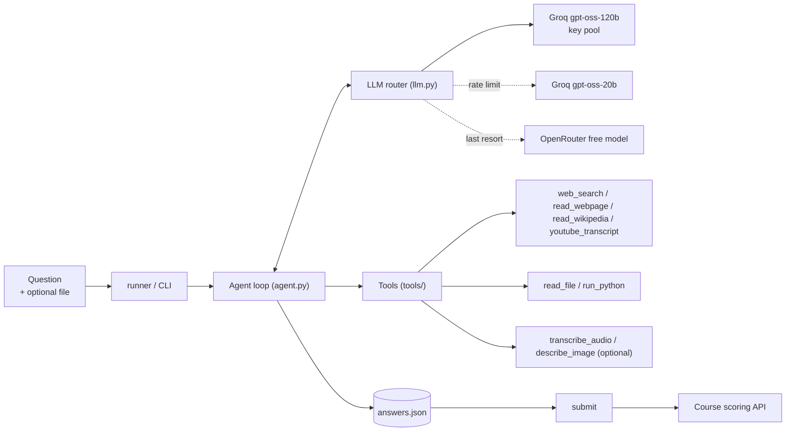

# GAIA Agent

A small, framework-free **tool-using LLM agent** built for the final project (Unit 4) of the
[Hugging Face Agents Course](https://huggingface.co/learn/agents-course). It answers questions from the course's subset of the
[GAIA benchmark](https://huggingface.co/datasets/gaia-benchmark/GAIA) (web research, Wikipedia history, PDFs, spreadsheets,
Python files, audio and YouTube transcripts) using only **free-tier LLM APIs**, and you can also ask it your own questions.

**Result:** 55% on the course's scoring API (GAIA level-1 subset, 20 questions; the course certificate needs 30%).
Public code Space: <https://huggingface.co/spaces/NimaEbrahimi/Final_Assignment_Template>

## Highlights

- **Own agent loop (~150 lines)** on native OpenAI-style tool calling, no agent framework: every step is visible in the logs.
- **Resilient LLM layer:** a [LiteLLM](https://github.com/BerriAI/litellm) `Router` over several API keys with fallbacks
  (Groq 120b -> Groq 20b -> OpenRouter). It waits for short rate limits and stops early, with a clear message, when the daily quota is gone.
- **Seven tools:** web search, web page / PDF reader, Wikipedia reader with *historical revisions*, YouTube transcripts, file reader,
  Python runner, and optional Whisper transcription and image description.
- **Token-aware web reading:** pages are converted to Markdown, split by headings, and only the sections that match the question are returned.
- **Exact-match friendly:** the model ends with `FINAL ANSWER: ...`; the answer is parsed and normalised before it is stored.
  Missing markers get a nudge, and a long unmarked reply becomes `UNKNOWN` instead of a wrong sentence.
- **Offline test suite** (no network, no keys) and CI.

## Architecture



## Quick start

Requires Python 3.10+ and at least one free API key ([Groq](https://console.groq.com); [OpenRouter](https://openrouter.ai) is a good fallback).

```bash
git clone <https://github.com/Ebrahimi-Nima/gaia-agent.git> gaia-agent
cd gaia-agent
python -m venv .venv && source .venv/bin/activate
pip install .                 # add ".[audio]" for local Whisper (large download, needs ffmpeg)
cp .env.example .env          # then put your key(s) in .env
gaia-agent check              # tests every key with a tool-calling request
gaia-agent ask "What is the capital of the country whose flag has a maple leaf?"
```

`ask` needs neither GAIA data nor a Hugging Face token. Answers are deliberately terse (benchmark style: a number, a few words
or a comma-separated list), because the agent is built for exact-match grading.

Attach a file the question refers to (spreadsheet, CSV, PDF, text/code, audio):

```bash
gaia-agent ask "What is the sum of the Sales column?" --file report.xlsx
```

### With Docker

```bash
docker build -t gaia-agent .
docker run --rm --env-file .env gaia-agent ask "Who wrote the novel Persuasion?"
```

The Docker image has not been tested by the author yet; it keeps the code (and `run_python`) away from your host files, but the
API keys are still visible to the process inside the container.

## The GAIA course questions

Extra requirements: a Hugging Face account that accepted the terms of the gated
[GAIA dataset](https://huggingface.co/datasets/gaia-benchmark/GAIA), a read token as `HF_TOKEN`, and `HF_USERNAME` to submit.

```bash
gaia-agent run --limit 2         # smoke test
gaia-agent run                   # everything (free tiers pause when rate limited)
gaia-agent run --missing         # only questions without a good answer yet
gaia-agent answers               # review the stored answers
gaia-agent submit --code-url https://huggingface.co/spaces/<user>/<space>/tree/main --dry-run
gaia-agent submit --code-url https://huggingface.co/spaces/<user>/<space>/tree/main
```

| `run` flag | Meaning |
|---|---|
| `--only 1,3,5` | Run only these 1-based question numbers |
| `--limit N` | Run at most N questions |
| `--skip-files` | Skip questions with attachments |
| `--missing` | Skip questions that already have a good stored answer (resume) |
| `--pause S` | Seconds between questions (default 5; eases per-minute token limits) |
| `--preview N` | Characters of each tool result to print |
| `--quiet` | Hide per-step tool logs |
| `--refresh` | Re-download the question list |

Questions, attachments and answers are stored in `data/` (override with `GAIA_DATA_DIR`). If the provider's daily quota is
exhausted, the run stops with a message; run again later with `--missing`.

### In a Kaggle or Colab notebook

Add your keys under the notebook's Secrets panel (Kaggle needs *Internet* on and the secrets attached), then:

```python
!git clone <https://github.com/Ebrahimi-Nima/gaia-agent.git> gaia-agent
!pip install -q ./gaia-agent
from gaia_agent import config
config.SECRET_ALIASES.update({"GROQ_API_KEY_1": "groq1", "HF_TOKEN": "hf-token"})  # only if your secret names differ
print(config.load_secrets())
from gaia_agent.runner import run_questions
run_questions(limit=2)
```

## Configuration

Settings come from Kaggle/Colab secrets, environment variables or a `.env` file (see [`.env.example`](.env.example)).

| Variable | Purpose |
|---|---|
| `GROQ_API_KEY_1` ... `_5` | Groq keys. Keys of the same account share one quota. |
| `OPENROUTER_API_KEY_1` ... `_5` | Last fallback when Groq is rate limited. |
| `GROQ_MODEL`, `GROQ_MODEL_2`, `OPENROUTER_MODEL` | LiteLLM model IDs. Provider catalogs change often: check them first. |
| `HF_TOKEN` | Read token for downloading GAIA attachments. |
| `HF_USERNAME` | Your Hugging Face username (used by `submit`). |
| `EMAIL` | Contact address in the Wikipedia User-Agent. |
| `VISION_MODEL` | Enables the `describe_image` tool (any vision-capable LiteLLM model ID). |
| `WHISPER_MODEL` | Whisper size, default `small`. |
| `GAIA_DATA_DIR` | Where questions, attachments and answers are stored. |

## Tools

| Tool | What it does |
|---|---|
| `web_search` | DuckDuckGo search with backend retries; filters ads and sources that only mirror benchmark questions. |
| `read_webpage` | Fetches an HTML page or PDF and returns the sections that match the `question` argument. Private/internal hosts are refused. |
| `read_wikipedia` | English Wikipedia through the MediaWiki API, optionally **as of a date** (for "2022 version" style questions). |
| `youtube_transcript` | Spoken-word transcript of a YouTube video (speech only; may be blocked on cloud IPs). |
| `read_file` | Previews spreadsheets, CSV, PDF and text/code files. |
| `run_python` | Runs a snippet or an attached `.py` file in a subprocess (key-like environment variables are removed). |
| `transcribe_audio` | Local [Whisper](https://github.com/openai/whisper) transcription; registered only when Whisper is installed. |
| `describe_image` | Vision model call; registered only when `VISION_MODEL` is set. |

## Project layout

```text
gaia_agent/
  agent.py      system prompt, agent loop, answer parsing, history trimming
  llm.py        LiteLLM router, rate-limit waiting, quota detection, health check
  config.py     secrets (Kaggle / Colab / env / .env) and the data folder
  client.py     questions + attachments (gated GAIA dataset, API fallback)
  store.py      answers.json (UNKNOWN or errors never overwrite a good answer)
  runner.py     run the agent over the questions
  submit.py     send answers to the scoring API
  cli.py        gaia-agent {check,ask,run,answers,submit}
  tools/        web.py, files.py, audio.py, vision.py
tests/          offline tests
```

## Development

```bash
pip install -e ".[dev]"
python -m pytest -q
```

The tests use a fake LLM and fake network calls, so they need no keys.

## Design notes

- **No agent framework.** A plain loop over native tool calling was easier to debug than an abstraction layer: when a model printed a
  tool call as text, or a provider rejected an unknown field, the cause was visible immediately.
- **Silent fallbacks hide failures.** The step log prints which model answered each call, so a dead primary model cannot quietly burn the fallback's quota.
- **Quotas are per account, not per key.** Rotating several keys of one account does not multiply the limits; use separate accounts or a different provider as fallback.
- **Rate limits need two behaviours.** Short per-minute limits are worth waiting for; a "try again in 40 minutes" message means the daily quota is gone, and the run should stop instead of failing every remaining question.
- **Sanitise assistant messages.** Messages are rebuilt with the fields every provider accepts, so history produced by one provider is accepted by another.
- **Cap the context.** Older tool results are truncated and decoding is deterministic (`temperature=0`), which keeps token use and run-to-run variance down on free tiers.
- **Lossless conversion beats clever extraction.** Pages are converted to Markdown and sections are chosen by keyword, so the model never sees invented page text.
- **Do not trust mirrors of the benchmark.** Crossword and puzzle sites that repeat the questions are blocked as evidence.

## Limitations

- `run_python` executes model-written code **without a sandbox**, with your user's permissions. Use a container or a throw-away machine, and keep secrets out of reach.
- Image and video questions need the optional vision model; the YouTube tool reads speech only.
- Free tiers have strict per-minute and per-day limits; a full run can pause or stop.
- Section selection is keyword-based: a question that shares no words with the target section may need a second, rephrased lookup.
- Answers can vary between runs when a question allows several valid readings.

## Benchmark data

GAIA validation questions and files are gated and must not be redistributed. This repository contains **no benchmark files and no answers**;
`data/` is created locally when you run the project and is git-ignored.

## Acknowledgements

- This project started from an agent written by a friend and was refactored into a tested, modular package with new tools and rate-limit handling.
- [Hugging Face Agents Course](https://huggingface.co/learn/agents-course) and the [GAIA benchmark](https://huggingface.co/datasets/gaia-benchmark/GAIA).
- [LiteLLM](https://github.com/BerriAI/litellm), [OpenAI Whisper](https://github.com/openai/whisper), [PyMuPDF](https://pymupdf.readthedocs.io), [markdownify](https://github.com/matthewwithanm/python-markdownify).

## License

[MIT](LICENSE).